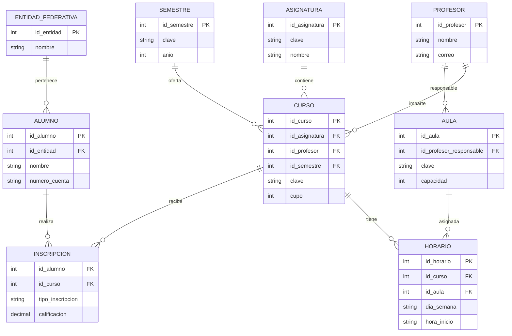

# Sistema de Control Escolar

## Descripción general
Sistema para administrar la información académica y administrativa de una
institución educativa: alumnos, profesores, asignaturas, cursos, horarios,
aulas, semestres e inscripciones. Parte del modelo de datos normalizado
(3FN) de 9 tablas diseñado en la materia de Sistemas Manejadores de Bases
de Datos Relacionales, y ahora se implementa como aplicación con Spring Boot.

## Integrantes
-Aguiñiga Olvera Alejando
-Franco Solando Juan Pablo
-Vazquez Alvarez Osvaldo

## Requerimientos (primeros 5)
| ID | Requerimiento | Descripción |
|---|---|---|
| RF-01 | Gestión de alumnos | Alta, consulta, modificación y baja de alumnos |
| RF-02 | Gestión de profesores | Registro de profesores y asignación a cursos |
| RF-03 | Catálogos de asignaturas y semestres | Registro de materias y periodos escolares |
| RF-04 | Cursos, horarios y aulas | Ofertar cursos y asignar horarios y aulas sin empalmes |
| RF-05 | Inscripciones | Inscribir alumnos a cursos validando cupo y registrar calificación |

## Funcionalidades que Spring Boot puede resolver con paquetes
| Funcionalidad | Paquete |
|---|---|
| API REST | spring-boot-starter-web |
| Conexión a base de datos | spring-boot-starter-data-jpa + driver de Oracle |
| Validación de datos | spring-boot-starter-validation |
| Autenticación y seguridad | spring-boot-starter-security |
| Logs | SLF4J / Logback |
| Documentación de la API | springdoc-openapi (Swagger) |
| Monitoreo | spring-boot-starter-actuator |
| Pruebas | spring-boot-starter-test |

## Cómo ejecutar
1. Abrir el repositorio en VS Code y elegir "Reopen in Container".
2. Ejecutar `./mvnw spring-boot:run`.
3. Abrir http://localhost:8080

## Relaciones 1:N
Después de analizar el modelo de datos se identificaron las siguientes relaciones de cardinalidad uno a muchos (1:N):

- Una Entidad Federativa puede tener muchos Alumnos.
- Un Profesor puede impartir muchos Cursos.
- Un Profesor puede ser responsable de muchas Aulas.
- Una Asignatura puede estar asociada a muchos Cursos.
- Un Semestre puede contener muchos Cursos.
- Un Curso puede tener muchos Horarios.
- Un Aula puede tener muchos Horarios.
- Un Alumno puede realizar muchas Inscripciones.
- Un Curso puede recibir muchas Inscripciones.



## Adaptación a Objetos
Las relaciones identificadas en la base de datos fueron adaptadas a un modelo orientado a objetos mediante el uso de colecciones. Esto permite representar las relaciones uno a muchos utilizando listas de objetos dentro de las clases correspondientes.

Por ejemplo:

- Una EntidadFederativa contiene una colección de Alumno.
- Un Profesor contiene una colección de Curso.
- Un Curso contiene una colección de Horario.
- Un Curso contiene una colección de Inscripcion.
- Un Alumno contiene una colección de Inscripcion.

```mermaid
classDiagram

class EntidadFederativa{
    s1
}

class Alumno{
    s2
}

class Profesor{
    s3
}

class Asignatura{
    s4
}

class Semestre{
    s5
}

class Curso{
    s6
}

class Aula{
    s7
}

class Horario{
    s8
}

class Inscripcion{
    s9
}

EntidadFederativa "1" --> "*" Alum*o : alumnos
Profesor "1" --> "*" Curso : cursos
Profesor "1" --> "*" Aula : aulas
Asignatur* "1" -->*"*" Curso : cursos
Semestre "1" --> "*" Curso : cursos*Curso "1" --> "*" Horario : horarios
Aula "1" --> "*" Horario : horarios
Alumno "1" --> "*" Inscripcion : inscripciones
Curso "1" --> "*" Inscripcion : inscripc*ones
```

