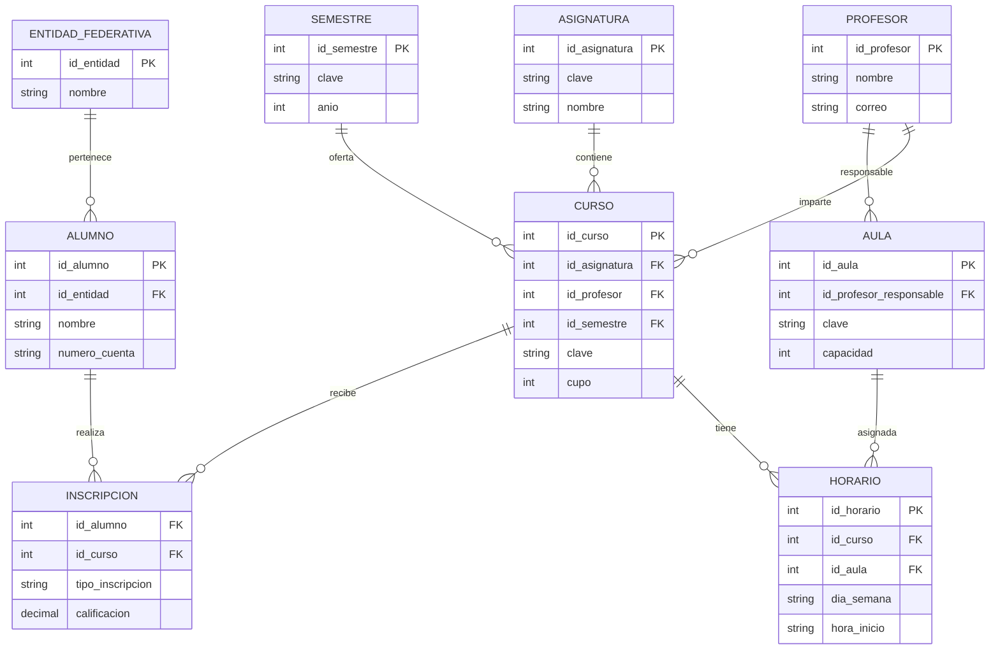
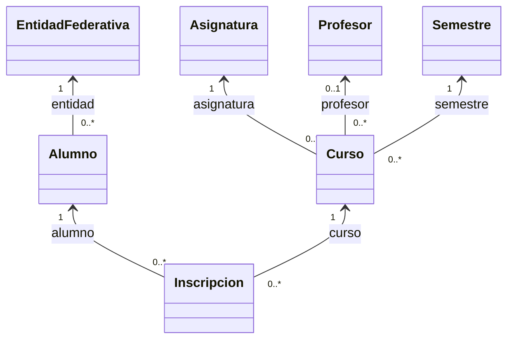

# Sistema de Control Escolar

## Descripción general
Sistema para administrar la información académica y administrativa de una
institución educativa: alumnos, profesores, asignaturas, cursos, horarios,
aulas, semestres e inscripciones. Parte del modelo de datos normalizado
(3FN) de 9 tablas diseñado en la materia de Sistemas Manejadores de Bases
de Datos Relacionales, y ahora se implementa como aplicación con Spring Boot.

## Integrantes
- Aguiñiga Olvera Alejandro
- Franco Solando Juan Pablo
- Vazquez Alvarez Osvaldo

## Requerimientos (primeros 5)
| ID | Requerimiento | Descripción |
|---|---|---|
| RF-01 | Gestión de alumnos | Alta, consulta, modificación y baja de alumnos |
| RF-02 | Gestión de profesores | Registro de profesores y asignación a cursos |
| RF-03 | Catálogos de asignaturas y semestres | Registro de materias y periodos escolares |
| RF-04 | Cursos, horarios y aulas | Ofertar cursos y asignar horarios y aulas sin empalmes |
| RF-05 | Inscripciones | Inscribir alumnos a cursos validando cupo y registrar calificación |

## Funcionalidades que Spring Boot puede resolver con paquetes
| Funcionalidad | Paquete |
|---|---|
| API REST | spring-boot-starter-web |
| Conexión a base de datos | spring-boot-starter-data-jpa + driver de Oracle |
| Validación de datos | spring-boot-starter-validation |
| Autenticación y seguridad | spring-boot-starter-security |
| Logs | SLF4J / Logback |
| Documentación de la API | springdoc-openapi (Swagger) |
| Monitoreo | spring-boot-starter-actuator |
| Pruebas | spring-boot-starter-test |

## Cómo ejecutar

1. Abre el repositorio en VS Code con Docker Desktop en ejecución y elige **Dev Containers: Reopen in Container**.
2. En una terminal Bash del contenedor, define `DEMO_JWT_SECRET` para firmar y validar tokens. Define `DEMO_ADMIN_PASSWORD` para crear la cuenta local `admin` al iniciar la aplicación.

   ```bash
   export DEMO_JWT_SECRET="$(openssl rand -base64 32)"
   read -rsp 'Contraseña del administrador local: ' DEMO_ADMIN_PASSWORD
   echo
   export DEMO_ADMIN_PASSWORD
   ./mvnw spring-boot:run
   ```

3. Abre la [API local](http://localhost:8080) o la [interfaz de Swagger](http://localhost:8080/swagger-ui/index.html).

La configuración local usa H2 en memoria. Al detener la aplicación se pierden los registros de prueba.

## Swagger y autenticación JWT

Swagger muestra las operaciones y permite ejecutarlas desde el navegador. La especificación OpenAPI está disponible en [`/v3/api-docs`](http://localhost:8080/v3/api-docs).

1. Para crear una cuenta de prueba, abre `POST /auth/register` y envía un JSON con `username` y `password`. Las cuentas nuevas reciben el rol `USER`.
2. Ejecuta `POST /auth/login` con esos mismos campos. La cuenta `admin` usa la contraseña configurada al arrancar la API.
3. Copia el valor de `accessToken`. En Swagger, pulsa **Authorize**, pégalo en **bearerAuth** y confirma. Swagger envía el encabezado `Authorization: Bearer <token>` en las operaciones protegidas.

### Endpoints y permisos

| Método | Rutas | Acceso |
|---|---|---|
| POST | `/auth/register`, `/auth/login` | Público |
| GET | `/asignaturas`, `/entidades`, `/profesores`, `/semestres`, `/cursos`, `/alumnos` | Público |
| GET | `/asignaturas/{id}`, `/profesores/{id}`, `/semestres/{id}`, `/cursos/{id}`, `/alumnos/{id}` | Público |
| GET | `/inscripciones`, `/alumnos/{idAlumno}/inscripciones`, `/cursos/{idCurso}/inscripciones` | Público |
| POST | `/asignaturas`, `/entidades`, `/profesores`, `/semestres`, `/cursos`, `/alumnos` | `ADMIN` |
| POST | `/inscripciones` | `USER` o `ADMIN` |
| DELETE | `/inscripciones/{idAlumno}/{idCurso}/{tipo}` | `USER` o `ADMIN` |

En una ruta protegida, la API devuelve `401 Unauthorized` cuando falta un token válido y `403 Forbidden` cuando la cuenta autenticada carece del rol requerido.

## Relaciones 1:N

El diagrama representa el modelo académico original de nueve tablas. Aula y Horario forman parte del diseño.

Después de analizar el modelo de datos se identificaron las siguientes relaciones de cardinalidad uno a muchos (1:N):

- Una Entidad Federativa puede tener muchos Alumnos.
- Un Profesor puede impartir muchos Cursos.
- Un Profesor puede ser responsable de muchas Aulas.
- Una Asignatura puede estar asociada a muchos Cursos.
- Un Semestre puede contener muchos Cursos.
- Un Curso puede tener muchos Horarios.
- Un Aula puede tener muchos Horarios.
- Un Alumno puede realizar muchas Inscripciones.
- Un Curso puede recibir muchas Inscripciones.



## Adaptación a objetos

La implementación JPA representa las relaciones desde el lado que contiene la llave foránea con `@ManyToOne`. Por ejemplo, un alumno pertenece a una entidad federativa y un curso referencia su asignatura y semestre. El profesor de un curso es opcional. El siguiente diagrama muestra las relaciones académicas implementadas.



## Relación muchos a muchos entre alumnos y cursos

Un alumno puede inscribirse en varios cursos y cada curso puede tener varios alumnos. La entidad intermedia `Inscripcion` conecta ambos y guarda datos propios como la fecha, el estatus y la calificación. Su clave compuesta incluye `idAlumno`, `idCurso` y `tipoInscripcion`. JPA la representa con `@EmbeddedId`, `@MapsId` y dos relaciones `@ManyToOne`.

Con una cuenta `USER` o `ADMIN`, envía este cuerpo a `POST /inscripciones`. Sustituye los números por los IDs que devuelvan `GET /alumnos` y `GET /cursos`.

```json
{
  "idAlumno": 1,
  "idCurso": 1,
  "tipoInscripcion": "ordinaria",
  "modoInscripcion": "presencial"
}
```

La creación exitosa devuelve `201 Created`. Una inscripción duplicada o un curso sin cupo devuelve `409 Conflict`. Consulta la inscripción con `GET /alumnos/{idAlumno}/inscripciones` y `GET /cursos/{idCurso}/inscripciones`. La baja mediante `DELETE /inscripciones/{idAlumno}/{idCurso}/{tipo}` devuelve `204 No Content` cuando se completa.

## Pruebas de integración

Con la API arrancada, abre otra terminal Bash en la raíz del repositorio, introduce la misma contraseña del administrador y ejecuta el script.

```bash
read -rsp 'Contraseña del administrador local: ' DEMO_ADMIN_PASSWORD
echo
export DEMO_ADMIN_PASSWORD
bash test-api.sh
```

El script comprueba Swagger, el acceso público, los permisos con JWT y el flujo de inscripciones. Crea datos de prueba en la base local. Revisa el resumen final y confirma en Swagger el código `201` de cada alta de catálogo, ya que para esas altas el script comprueba el ID devuelto.
